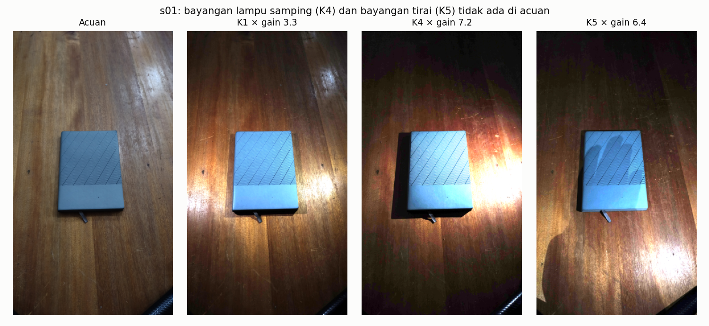
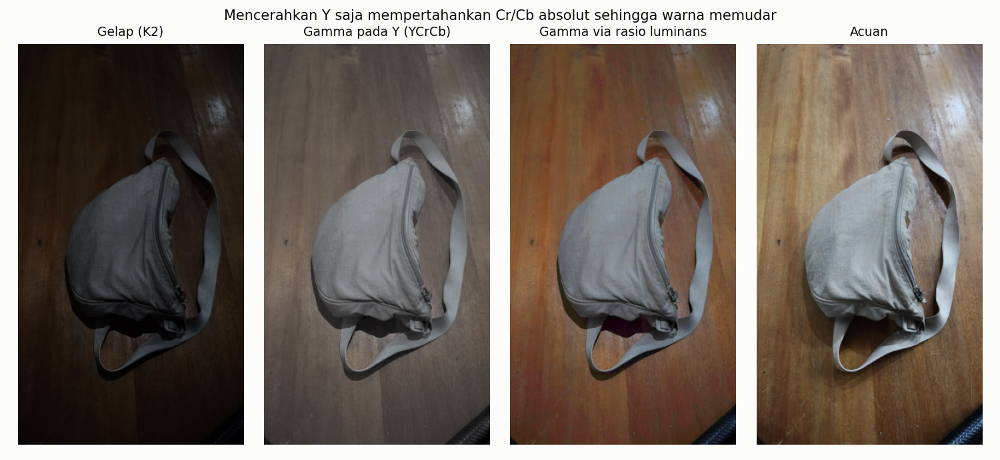
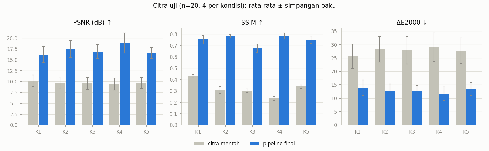
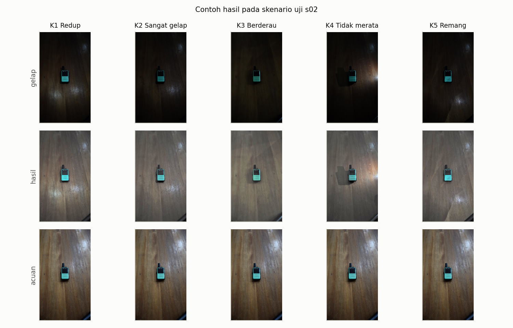
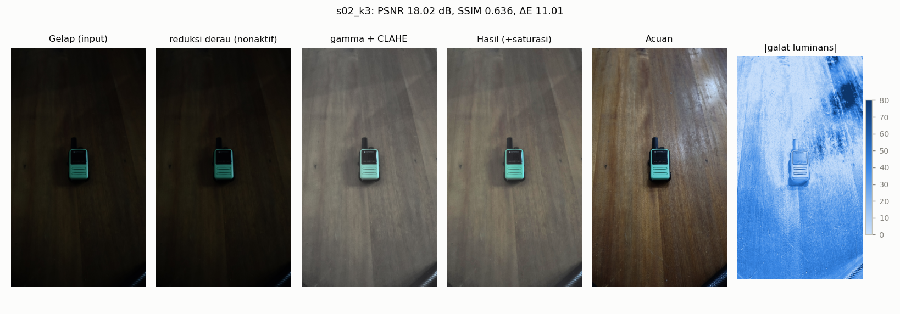

## 3. Dataset

**Pengambilan.** Sepuluh skenario benda di atas meja kayu (s01-s10) dipotret
sendiri dengan ponsel TECNO CN7c (f/1,8, 5,56 mm) pada penyangga tetap, 11 Oktober
2026. Tiap skenario terdiri dari satu acuan dan lima citra gelap: total 60 citra
JPEG 2304×4096, 50 pasangan evaluasi.

| Jenis | Kondisi | ISO | Rana | Luminans rata-rata (rentang) |
|---|---|---|---|---|
| Acuan | semua lampu menyala | 800 | 1/20 s | 98,4 (85,6-119,0) |
| K1 | Redup: sebagian lampu mati | 100 | 1/30 s | 32,2 (22,4-45,3) |
| K2 | Sangat gelap: satu lampu kecil | 100 | 1/30 s | 22,6 (16,0-32,3) |
| K3 | Berderau: cahaya redup, ISO tinggi | 3200 | 1/90 s | 25,3 (18,1-34,7) |
| K4 | Tidak merata: satu lampu dari samping | 100 | 1/30 s | 19,9 (12,2-30,6) |
| K5 | Remang: tirai tertutup, tanpa lampu | 100 | 1/30 s | 24,5 (13,7-36,5) |

Angka ISO/rana dibaca dari EXIF (`data/metadata.csv`). K4 ternyata kondisi paling
gelap, dan K5 tidak lebih gelap dari K2.

**Ground truth.** Acuan adalah foto adegan yang sama dengan pencahayaan ruangan
penuh, tanpa penyuntingan. Acuan sendiri tidak sempurna: ISO 800 masih menyisakan
derau halus dan ada pantulan lampu di meja.

**Validasi pasangan.** `audit_dataset.py` mencocokkan magnitudo gradien
(tidak peka terhadap kecerahan) antara acuan dan citra gelap. Pergeseran global
median 0,22 px (maks. 1,30 px pada skala 1/4), rotasi maks. 0,2°. Dua pasangan
K3 melewati ambang 1 px, tetapi mengompensasi pergeserannya tidak mengubah SSIM
(≤ 0,006): itu efek derau pada estimasi. Ke-50 pasangan dipakai.

**Perbedaan adegan.** Kamera tidak bergeser, tetapi cahaya mengubah isi citra:
bayangan keras di K4, bayangan tirai di K5, dan posisi pantulan meja yang berbeda
(Gambar 1). Galat ini tidak bisa dihapus metode apa pun yang tidak melihat acuan.

<figure>
<figcaption>Gambar 1. s01 dengan kecerahan disamakan ke acuan: bayangan K4 dan K5 tidak ada di acuan.</figcaption></figure>

**Pembagian data.** Per skenario dengan seed 42 (`data/split.json`): dev s01, s03,
s04, s06, s07, s08 (30 citra) dan uji s02, s05, s09, s10 (20 citra). Pembagian per
skenario mencegah lima citra dari adegan yang sama bocor antara dev dan uji.
Runner eksperimen menolak memuat skenario uji, dan perilaku ini diuji oleh unit test.
**Privasi:** tidak ada wajah, plat nomor, atau informasi pribadi.

## 4. Rancangan pipeline

<b>1. Pra-pemrosesan</b> perkecil 1/4 (INTER_AREA) RGB → YCrCb

<b>2. Reduksi derau</b> diuji: median, Gaussian, bilateral, NLM <i>final: tidak dipakai</i>

<b>3. Kontras (kanal Y)</b> gamma adaptif (target 0,38) → CLAHE (clip 1,0, tile 16)

<b>4. Pasca-proses</b> gabung Y + CrCb → RGB saturasi ×1,5 <i>unsharp diuji, tidak dipakai</i>

Seluruh tahap dapat diatur lewat JSON (`src/pipeline.py`, `configs/final.json`),
termasuk urutan tahap 2-3 dan ruang warna, sehingga setiap eksperimen hanya
mengganti konfigurasi. Alasan tiap pilihan:

1. **Skala 1/4 dan YCrCb.** Citra 9,4 MP membuat NLM dan median dari nol butuh
   beberapa detik per citra; acuan diperkecil dengan cara yang sama. Kontras
   diperbaiki pada Y agar rona tidak bergeser (T31).
2. **Tanpa filter derau.** Memperkecil 4×4 dengan `INTER_AREA` merata-ratakan 16
   piksel, sehingga derau sudah turun ±4×; filter tambahan hanya mengaburkan
   tekstur (Bagian 6.2).
3. **Gamma adaptif + CLAHE ringan.** Gamma adaptif menyamakan kecerahan global per
   citra; CLAHE dengan clip minimum menambah kontras lokal tanpa halo.
4. **Saturasi.** Menaikkan Y tanpa menyentuh Cr/Cb membuat warna memudar
   (Gambar 2), jadi saturasi dikembalikan di akhir.

<figure>
<figcaption>Gambar 2. Gamma pada Y memudarkan warna; gamma via rasio luminans menjaga warna tetapi kelewat jenuh.</figcaption></figure>

## 5. Implementasi dari nol dan verifikasi

`src/from_scratch.py` hanya memakai NumPy.

- **Ekualisasi histogram.** Histogram dengan `np.bincount`, CDF dengan `np.cumsum`,
  LUT `round((cdf − cdf_min)·255/(N − cdf_min))`. Tiga detail disamakan dengan
  OpenCV: (1) citra konstan dikembalikan apa adanya, (2) faktor skala dihitung dalam
  float32, (3) pembulatan round-half-to-even (`np.rint`, setara `cvRound`).
- **Filter median.** Padding replikasi tepi (`np.pad(mode="edge")`, setara
  `BORDER_REPLICATE` OpenCV), jendela dengan `sliding_window_view`, elemen tengah
  dengan `np.partition`. Diproses per potongan baris agar memori sementara
  ≤ 64 MB. Karena k×k selalu ganjil, median adalah nilai tengah persis.

**Verifikasi** (`experiments/verify_from_scratch.py`) pada 10 citra gelap (2 per
kondisi): selisih piksel maksimum dan rata-rata = **0** untuk kedua operasi, pada
skala kerja maupun resolusi penuh. 57 unit test (citra konstan, 1×N, ukuran
ganjil/genap, k = 3/5/7/9, RGB, input tidak valid) juga lulus dengan selisih 0.

| Operasi (10 citra) | Resolusi | Versi sendiri | OpenCV | Rasio |
|---|---|---|---|---|
| Ekualisasi histogram | 576×1024 | 3,8 ms | 0,6 ms | 6× |
| Median 3×3 (RGB) | 576×1024 | 156 ms | 0,8 ms | 207× |
| Median 5×5 (RGB) | 576×1024 | 428 ms | 4,1 ms | 114× |
| Ekualisasi histogram | 2304×4096 | 59 ms | 3,6 ms | 17× |
| Median 3×3 (RGB) | 2304×4096 | 1,80 s | 9,9 ms | 185× |
| Median 5×5 (RGB) | 2304×4096 | 5,58 s | 37,7 ms | 148× |

Versi sendiri lebih lambat karena NumPy membuat salinan k² nilai per piksel lalu
mempartisinya, sedangkan OpenCV memakai algoritma median berbasis histogram
bergeser dan instruksi SIMD dalam C++. Kedua operasi dipakai di pipeline:
ekualisasi histogram sebagai metode pembanding (T29), dan median dari nol pada T30
memberi hasil identik dengan `cv2.medianBlur` di seluruh 30 citra dev.

## 6. Eksperimen (hanya dev)

Setiap tahap divariasikan dengan tahap lain dikunci. Metrik dihitung pada skala 1/4
untuk 30 citra dev; semua perbandingan berpasangan diuji dengan Wilcoxon
(`results/wilcoxon_dev.csv`).

### 6.1 Perbaikan kontras

<figure>
<figcaption>Gambar 3. Metode kontras dengan parameter bawaan, tanpa reduksi derau.</figcaption></figure>

Luminans rata-rata keluaran menjelaskan peringkatnya (acuan: rata-rata 96, simpangan
baku 36,5). HE memaksa histogram seragam sehingga terlalu terang dan terlalu kontras
(131; 72,6). SSR/MSR merentangkan reflektansi ke 0-255 sehingga jauh terlalu terang
(±173). CLAHE tunggal hanya menaikkan kontras lokal dan tetap terlalu gelap (43).
Gamma adaptif tepat mengenai kecerahan (97) tetapi kontrasnya kurang (24,8), dan
celah inilah yang coba diisi CLAHE ringan pada tuning (Bagian 6.4). Gamma adaptif mengalahkan
gamma 0,5 pada PSNR dan ΔE (24/30 citra, p < 0,001) karena kecerahan citra gelap
bervariasi antarskenario (22-45 pada K1). Pada parameter bawaan, menambahkan
CLAHE (clip 1,5) tidak menaikkan SSIM (p = 0,81) dan menurunkan PSNR (p < 0,001).

### 6.2 Reduksi derau dan pengaruh resolusi

Pada skala 1/4, **semua** filter menurunkan SSIM, termasuk pada K3 (ISO 3200):
tanpa filter 0,723, median 3×3 0,690, bilateral 0,680, NLM h=3 0,680 (tanpa filter
lebih baik di 27/30 citra, p < 0,001). Dugaan penyebabnya, memperkecil dengan
`INTER_AREA` sudah meredam derau, diuji dengan mengulang eksperimen pada skala
1/2 dan penuh (Gambar 4). Pada resolusi penuh urutannya terbalik: median dan
bilateral unggul, dan pada K3 bilateral menaikkan SSIM dari 0,645 ke 0,701.
Kesimpulannya, kebutuhan reduksi derau bergantung pada resolusi kerja.

<figure>
<figcaption>Gambar 4. SSIM dev per metode reduksi derau pada tiga resolusi.</figcaption></figure>

### 6.3 Urutan, ruang warna, dan warna

- **Ruang warna:** YCrCb (SSIM 0,723) > Lab 0,718 ≈ RGB per kanal 0,718 > rasio
  luminans 0,703 > HSV 0,700. Per kanal RGB menggeser rona (ΔE +0,77, p < 0,001).
- **Urutan:** untuk NLM, denoise sebelum kontras lebih baik (SSIM p < 0,001)
  karena derau belum diperkuat gamma. Untuk median 3×3 selisihnya < 0,001.
- **White balance gray-world** memperburuk 30/30 citra: citra gelap sudah sama
  hangatnya dengan acuan (rasio R/G 1,18-1,26 vs 1,10-1,13).
- **Saturasi:** penguatan ×1,2-1,4 memperbaiki ΔE (p < 0,001) tanpa mengubah SSIM.

### 6.4 Tuning parameter

Tuning bertahap dengan kriteria peringkat gabungan PSNR/SSIM/ΔE (lihat
`docs/parameter_rationale.md`). Target gamma adaptif 0,38 (SSIM tertinggi
dibanding 0,40, p = 0,007). CLAHE terbaik pada clip 1,0 dan tile 16 (Gambar 5);
clip lebih besar selalu menurunkan SSIM. Ukuran kernel 3/5/7 untuk median dan
Gaussian semuanya kalah dari tanpa filter. Unsharp dengan amount > 0 menurunkan
SSIM (29/30 citra, p < 0,001). Saturasi optimum 1,5 dari grid 1,0-2,5.

<figure>
<figcaption>Gambar 5. Grid CLAHE setelah gamma adaptif (dev). Bingkai = pilihan.</figcaption></figure>

## 7. Hasil dan pembahasan

### 7.1 Evaluasi akhir (citra uji, n = 20)

Konfigurasi dikunci (git tag `config-locked`) sebelum citra uji dievaluasi.

| Metode | PSNR (dB) ↑ | SSIM ↑ | ΔE2000 ↓ | Waktu (ms) |
|---|---|---|---|---|
| Citra mentah (baseline) | 9,68 ± 1,20 | 0,322 ± 0,067 | 27,73 ± 4,54 | - |
| Ekualisasi histogram (dari nol) | 11,12 ± 1,50 | 0,561 ± 0,092 | 20,84 ± 3,04 | 11 |
| CLAHE | 11,17 ± 1,20 | 0,504 ± 0,054 | 23,68 ± 3,89 | 5 |
| MSR | 11,50 ± 1,71 | 0,632 ± 0,095 | 22,76 ± 5,59 | 601 |
| Gamma 0,5 | 15,51 ± 1,53 | 0,720 ± 0,038 | 15,71 ± 2,87 | 7 |
| Gamma adaptif 0,4 | 17,16 ± 1,50 | 0,739 ± 0,041 | 13,21 ± 2,02 | 9 |
| **Pipeline final** | **17,21 ± 1,90** | **0,749 ± 0,049** | **12,84 ± 2,45** | 14 |

Pipeline final lebih baik dari baseline pada **20 dari 20** citra untuk ketiga metrik
(Wilcoxon p < 0,001; median kenaikan PSNR +7,2 dB, SSIM +0,41, ΔE −14,2).
Dibanding gamma adaptif standar, SSIM (+0,012, p = 0,002) dan ΔE (−0,51, p = 0,012)
lebih baik, sedangkan PSNR setara (p = 0,57). Pipeline butuh 14 ms per citra pada
skala kerja dan 177 ms pada resolusi penuh.

<figure>
<figcaption>Gambar 6. Baseline vs pipeline final per kondisi (citra uji).</figcaption></figure>

| Kondisi | PSNR mentah → final | SSIM mentah → final | ΔE mentah → final |
|---|---|---|---|
| K1 Redup | 10,22 → 16,18 | 0,428 → 0,753 | 25,64 → 13,89 |
| K2 Sangat gelap | 9,57 → 17,50 | 0,309 → 0,780 | 28,28 → 12,46 |
| K3 Berderau | 9,53 → 16,89 | 0,301 → **0,676** | 27,94 → 12,64 |
| K4 Tidak merata | 9,39 → 18,90 | 0,235 → 0,785 | 29,06 → 11,76 |
| K5 Remang | 9,67 → 16,56 | 0,338 → 0,751 | 27,71 → 13,42 |

K4 justru mendapat skor terbaik walau paling gelap; dugaan kami, lampu samping
memberi kontras lokal yang kuat sehingga struktur tetap terekam. K3 tertinggal paling jauh pada SSIM.

<figure>
<figcaption>Gambar 7. Skenario uji s02: gelap, hasil, dan acuan untuk K1-K5.</figcaption></figure>

### 7.2 Analisis kegagalan

Empat citra uji dengan SSIM terendah dipilih otomatis
(`experiments/failure_cases.py`): s02_k3 (0,636), s09_k3 (0,661), s05_k3 (0,684),
dan s09_k1 (0,709). Keluaran tiap tahap disimpan dan diukur
(`results/failures/stage_metrics.csv`).

<figure>
<figcaption>Gambar 8. Kasus terburuk s02_k3: hasil tampak halus/kabur dibanding acuan; galat terbesar di pantulan meja.</figcaption></figure>

| Kasus | Tahap penyebab | Bukti | Usulan |
|---|---|---|---|
| s02_k3, s05_k3, s09_k3 (K3) | **Pengambilan** (bukan pipeline): ISO 3200 + 1/90 s dan pengurangan derau internal ponsel menghapus tekstur kayu | Energi frekuensi tinggi keluaran hanya 0,51 (s02), 0,49 (s05), 0,82 (s09) × acuan; SSIM pita tengah 0,57-0,67; tahap kontras menaikkan SSIM 0,29 → 0,63 tetapi tidak bisa mengembalikan detail yang tidak terekam | Uji A: pemertajaman khusus ISO tinggi. Ambil K3 dengan rana lebih lama atau gabungkan beberapa bidikan (multi-frame averaging) |
| s09_k1, juga semua citra s09/s10 | **Tahap 3 (gamma adaptif)**: target kecerahan tetap 0,38 → luminans ±97, sedangkan acuan s09/s10 lebih terang (114-119) | Selisih luminans −18 s.d. −29 pada seluruh 10 citra s09/s10; menyamakan kecerahan menaikkan SSIM luminans hanya +0,01-0,04 tetapi ΔE turun hingga 5 (s09_k4: 14,8 → 9,8) | Target kecerahan tidak bisa diketahui tanpa acuan; perkirakan dari isi adegan atau biarkan pengguna mengatur. Laporkan sebagai batas metode global |
| s09_k1 (K1) | **Tahap 3 + adegan**: gradien cahaya berbeda dari acuan; derau gelap ikut diperkuat (frek. tinggi 1,32 × acuan) | SSIM pita bawah 0,63; porsi piksel dengan iluminasi relatif < 0,6× median paling tinggi di K1 (24%, dev) | Uji C: koreksi iluminasi lokal parsial |

**Hipotesis awal PRD.** K5 *tidak* hampir hitam (luminans 24,5, SSIM akhir 0,751).
Derau berwarna K3 bukan masalah utama setelah diperkecil; masalahnya tekstur yang
hilang. Halo CLAHE dihindari karena clip 1,0 terpilih; clip ≥ 2 memang menurunkan
SSIM. Saturasi piksel pada K4 kecil: ≤ 0,8% piksel keluaran bernilai ≥ 254 (acuan s09 sendiri 0,46%).

**Menguji usulan perbaikan** (`experiments/fix_eval.py`, disetel di dev, diuji sekali
di uji, terpisah dari hasil utama):

- **A. Pemertajaman untuk ISO ≥ 1600.** Ditolak di dev: setiap amount (0,25-2,0)
  menurunkan SSIM K3 (0,677 → 0,531) karena yang diperkuat adalah sisa derau,
  bukan tekstur. Hipotesis "kurang tajam" salah; informasi memang hilang saat pengambilan.
- **B. Mask bayangan untuk evaluasi K4/K5.** Ditolak: dengan mask berbasis rasio
  iluminasi, K1 (tanpa bayangan) justru memiliki porsi "bayangan" terbesar. Perbedaan
  iluminasi bersifat menyeluruh, bukan bayangan lokal saja.
- **C. Koreksi iluminasi parsial** <i>I</i>·(mean <i>L</i> / <i>L</i>)0,3,
  σ = 120, sebelum gamma. Di uji: ΔE 12,84 → 12,68 (p = 0,03), PSNR +0,03 dB
  (p = 0,19), SSIM −0,002 (p = 0,15). Paling membantu K1 (PSNR +0,39 dB, ΔE −0,61)
  dan merugikan K4 sedikit. Perbaikan nyata tetapi kecil; konfigurasi final tidak diubah.

## 8. Kesimpulan dan saran

1. Pipeline klasik 4 tahap (YCrCb → gamma adaptif → CLAHE ringan → saturasi)
   menaikkan PSNR 9,7 → 17,2 dB, SSIM 0,32 → 0,75, dan menurunkan ΔE 27,7 → 12,8
   pada citra uji, lebih baik dari baseline di seluruh 20 citra dan kelima kondisi.
2. Metode yang meratakan histogram (HE, CLAHE kuat, Retinex) kalah jauh dari
   gamma karena acuan bukan citra berhistogram seragam. Pilihan metode harus
   mengikuti bentuk target, bukan sekadar "kontras setinggi mungkin".
3. Ekualisasi histogram dan filter median dari nol identik dengan OpenCV
   (selisih 0 pada 10 citra dan 57 kasus uji), tetapi 6-207× lebih lambat.
4. Reduksi derau tidak membantu pada skala 1/4 tetapi membantu pada resolusi penuh.
   Keputusan rancangan bergantung pada resolusi kerja dan harus diuji ulang bila
   resolusinya berubah.
5. Kegagalan terbesar (K3) berasal dari informasi yang hilang saat pengambilan;
   batas kedua adalah kecerahan target dan gradien cahaya yang tidak dapat diketahui
   tanpa acuan.

**Keterbatasan.** Dev hanya 6 skenario dan uji 4 skenario dengan latar meja yang
sama, sehingga p-value bersifat indikatif dan generalisasi ke adegan lain belum
teruji. Acuan diambil pada ISO 800, bukan ISO dasar. Evaluasi utama pada skala 1/4.

**Saran.** (1) Pilih reduksi derau berdasarkan ISO EXIF bila memproses resolusi
penuh (median 3×3 atau bilateral untuk ISO tinggi). (2) Gabungkan koreksi
iluminasi parsial (perbaikan C) untuk kondisi redup. (3) Ambil acuan pada ISO 100
dengan tripod dan tambahkan adegan dengan latar berbeda.
